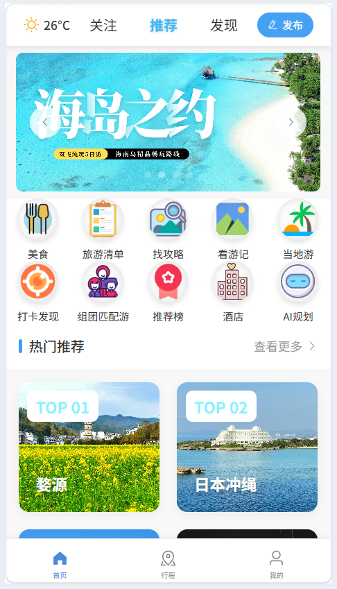
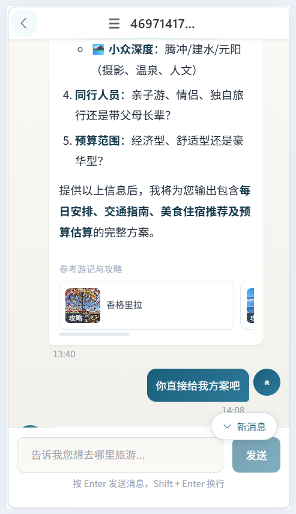
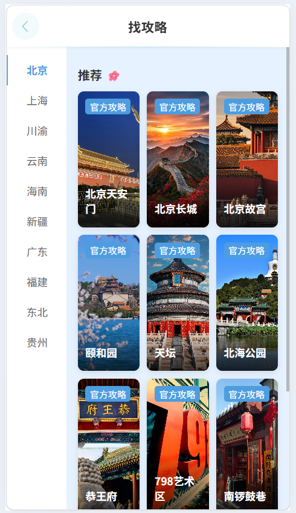
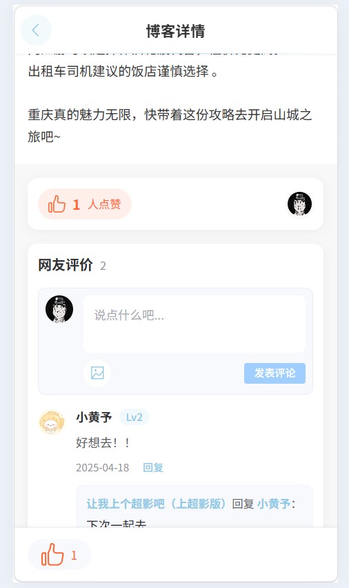
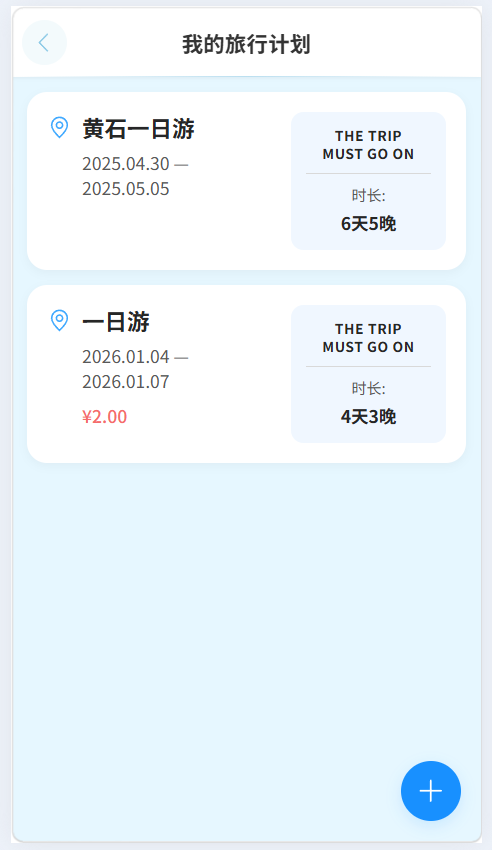

# Microway · 微途旅行

> 面向大学生的旅游平台：游记分享 · 攻略查找 · 行程规划 · AI 智能导览


## 项目简介

Microway（微途旅行）是一个前后端分离的大学生旅游平台。用户可以浏览热门目的地、查看官方攻略、分享游记、点赞评论互动，还能与内置的 **AI 旅行助手** 对话，由大模型结合站内游记与攻略（RAG）生成个性化行程方案。

## 功能特性

### 🏝️ 首页 · 内容分发
- 轮播图 + 金刚区入口（美食 / 旅游清单 / 找攻略 / 看游记 / 当地游 / 打卡发现 / 组团匹配游 / 推荐榜 / 酒店 / AI 规划）
- 热门目的地推荐（TOP 榜单）、关注 / 推荐 / 发现多 Tab 信息流

### 🤖 AI 旅行助手
- 基于 **Spring AI Alibaba（ReactAgent）** 的多轮对话，SSE 流式输出、思考过程可视化
- 大模型可自主调用站内工具（RAG 检索、联网搜索等），支持中途停止生成
- 回答内嵌「参考游记与攻略」卡片，点击可跳转详情；支持多会话管理与历史记录

### 📖 攻略与游记
- **找攻略**：按城市（北京 / 上海 / 川渝 / 云南 / 海南……）浏览官方攻略
- **看游记**：UGC 游记瀑布流，支持图文发布、视频发布
- **游记详情**：点赞（Redis 计数 + MQ 异步落库）、评论区（支持楼中楼回复、配图、等级展示）

### 🗺️ 行程规划
- 创建 / 管理个人旅行计划，展示行程周期与天数统计

### 🔔 其他
- 短视频浏览（上下滑切换、点赞）、消息通知、个人主页、地图导航（百度地图 GL）、扫码登录等

## 界面预览

| 首页 | AI 旅行助手 |
| --- | --- |
|  |  |

| 官方攻略 | 游记广场 |
| --- | --- |
|  |  |

| 游记详情（点赞 / 评论） | 我的旅行计划 |
| --- | --- |
|  |  |

## 技术栈

### 后端
| 分类 | 技术 |
| --- | --- |
| 基础框架 | Java 21 · Spring Boot 3.5 · Spring MVC · MyBatis-Plus |
| AI 能力 | Spring AI Alibaba 1.1（ReactAgent / Graph、Hook、Interceptor）、Spring AI OpenAI 兼容接入（阿里云百炼 DashScope）、MCP Client |
| RAG | pgvector（PostgreSQL）+ HNSW 向量索引 · DashScope text-embedding-v3 · 自研中文分片（chunk 500 / overlap 80） |
| 存储 | MySQL（业务库）· PostgreSQL（向量库）· Redis / Redisson（登录态、点赞计数、 feed 流） |
| 中间件 | RabbitMQ（点赞落库 / RAG 索引异步化）· XXL-Job（点赞对账） |
| 文档 | Knife4j（OpenAPI 3 / Swagger） |

### 前端
| 分类 | 技术 |
| --- | --- |
| 核心框架 | Vue 3.5（Composition API / `<script setup>`）· Vue Router 4（Hash 模式）· Pinia |
| UI 与构建 | Element Plus 2.9 · Vite 6 · Axios |
| 其他 | 百度地图 GL SDK · SSE 流式渲染 · 自定义设计令牌（`--wt-*`）体系 |

## 项目结构

```
wtlx/
├── src/main/java/com/wtlx/        # 后端源码
│   ├── controller/                 # 接口层（博客 / 评论 / 点赞 / AI / 地图…）
│   ├── service/                    # 业务层
│   ├── config/                     # ReactAgent、数据源、MVC 等配置
│   ├── infrastructure/             # 基础设施（RAG、MQ、取消令牌、拦截器…）
│   │   ├── rag/                    # 切片 / 打标 / 检索 / 卡片组装
│   │   ├── mq/                     # RabbitMQ 生产者与消费者
│   │   └── cancel/                 # AI 流式生成取消机制
│   └── tools/                      # Agent 工具注册
├── src/main/resources/             # 配置与提示词
├── wtlx-frontend/                  # 前端工程（Vue 3 + Vite）
│   ├── src/views/                  # 页面（40+ 视图）
│   ├── src/components/             # 公共组件
│   └── src/styles/                 # 设计令牌与全局样式
└── docs/screenshots/               # 界面截图
```

## 快速开始

### 环境要求
- JDK 21+ / Maven 3.9+
- Node.js 18+（推荐 20+）
- MySQL 8 · Redis · RabbitMQ · PostgreSQL（含 pgvector 扩展）

### 后端启动
```bash
# 1. 配置数据库连接：编辑 src/main/resources/application.yaml
# 2. 配置大模型 Key（环境变量）
export DASHSCOPE_API_KEY=sk-xxxx

# 3. 启动（默认端口 9528）
mvn spring-boot:run
```

### 前端启动
```bash
cd wtlx-frontend
npm install
npm run dev        # 开发环境，默认 http://localhost:5173
npm run build      # 生产构建，产物输出 dist/
```

## 接口文档

后端启动后访问：`http://localhost:9528/doc.html`（Knife4j）

## License

[MIT](LICENSE)
