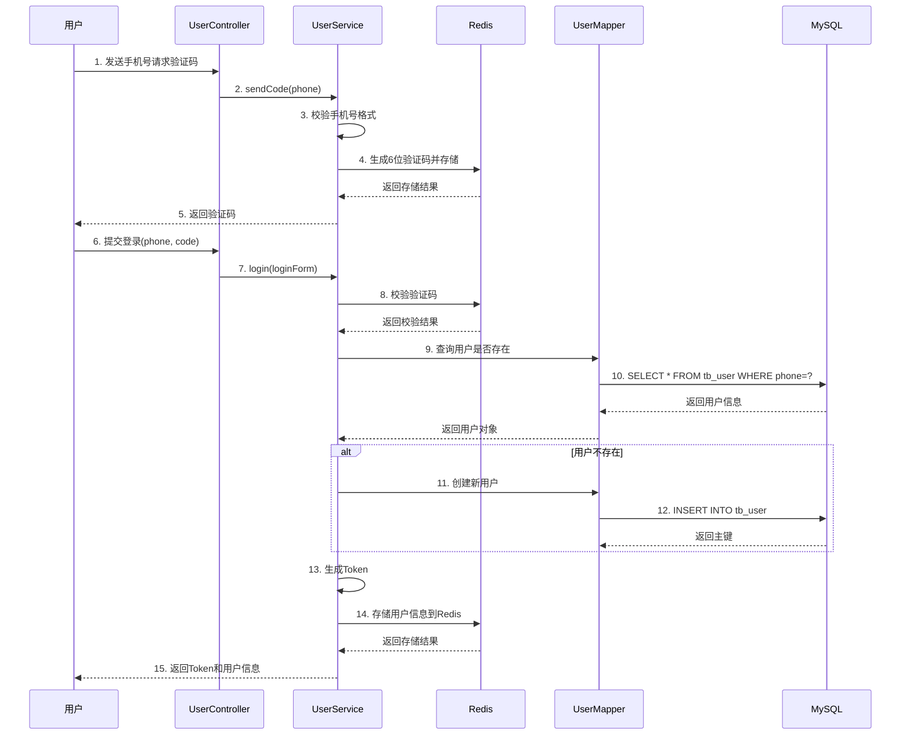
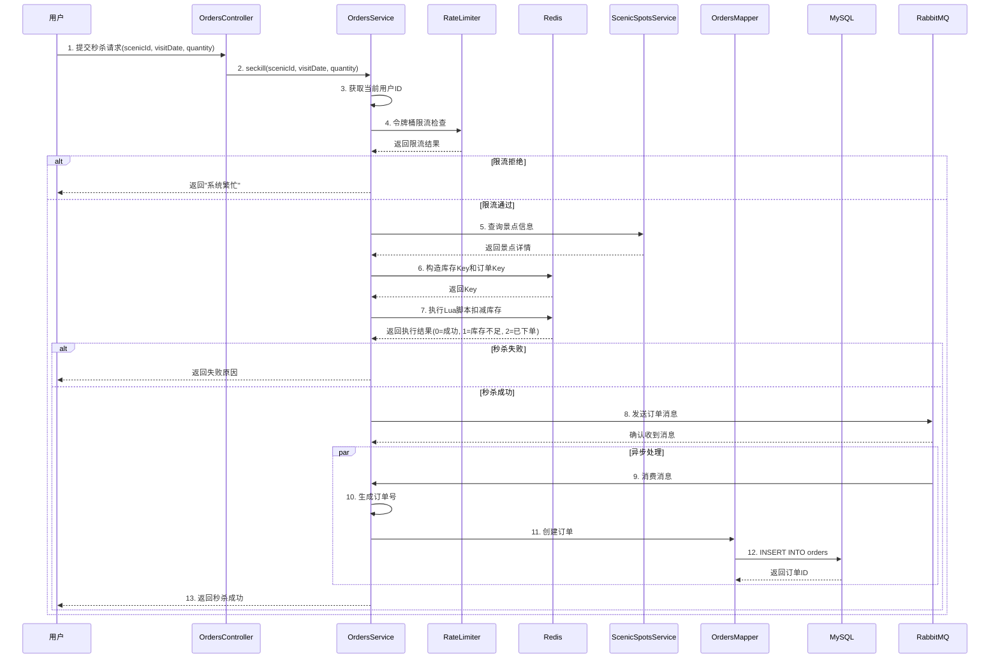
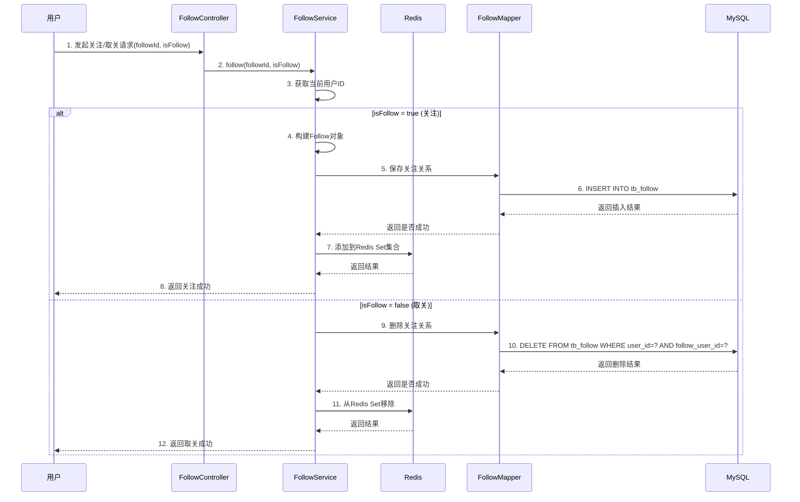
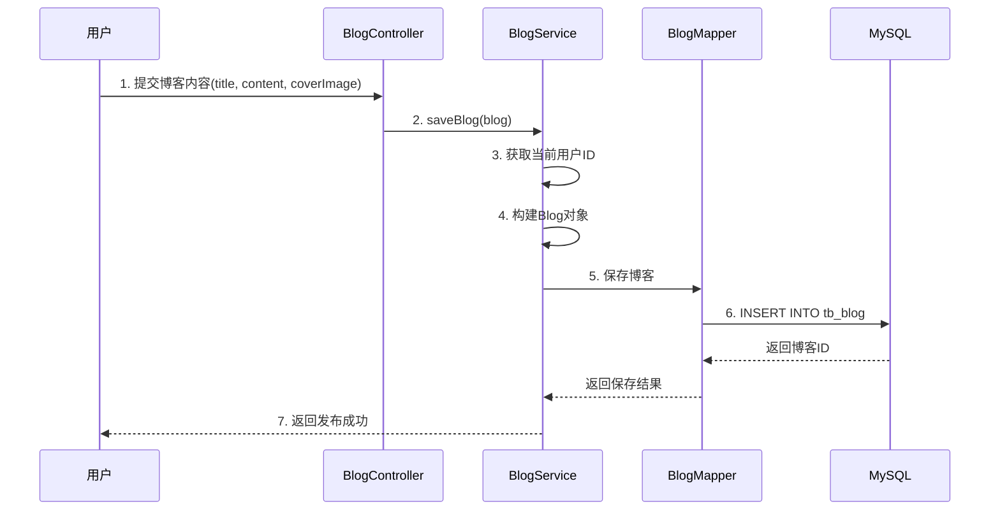
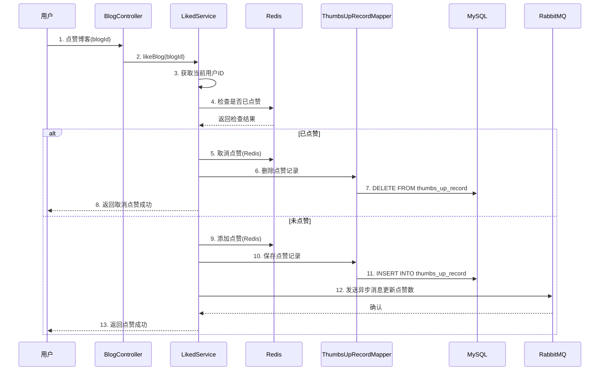
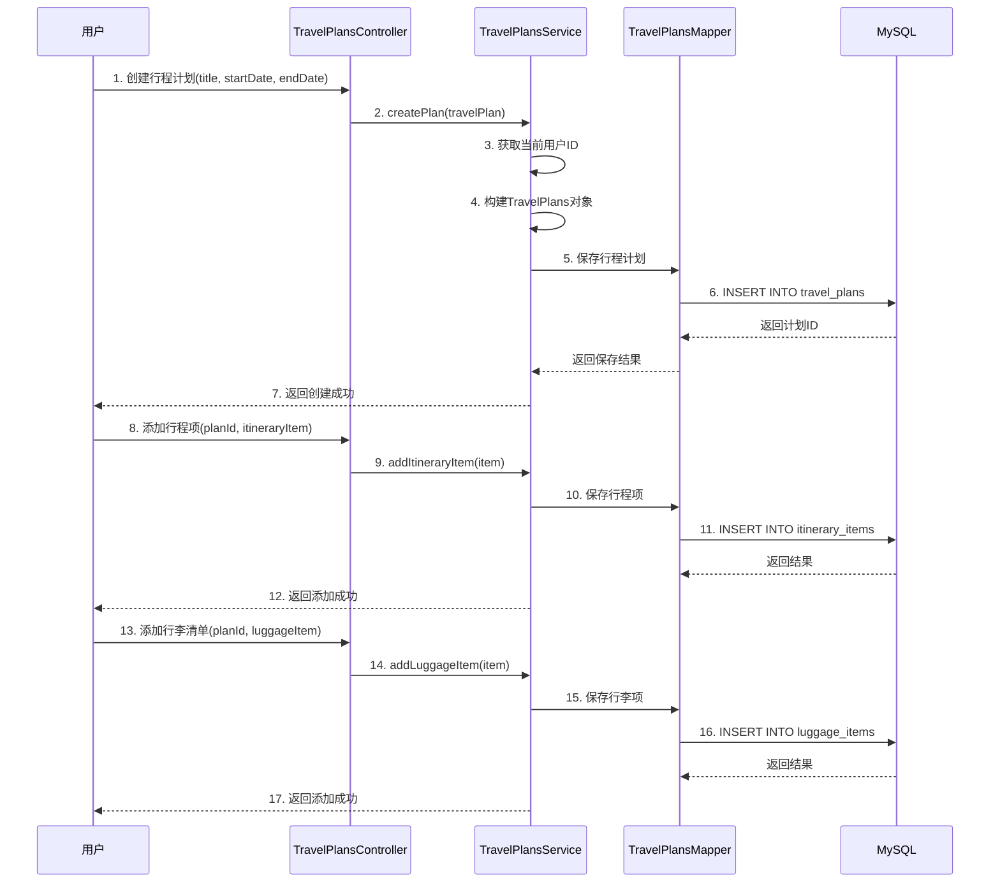
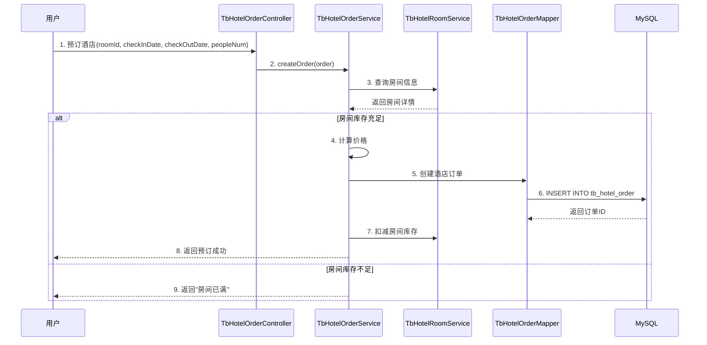
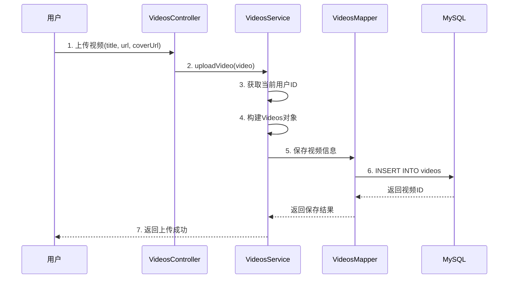
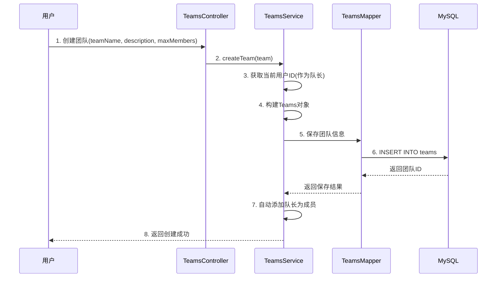
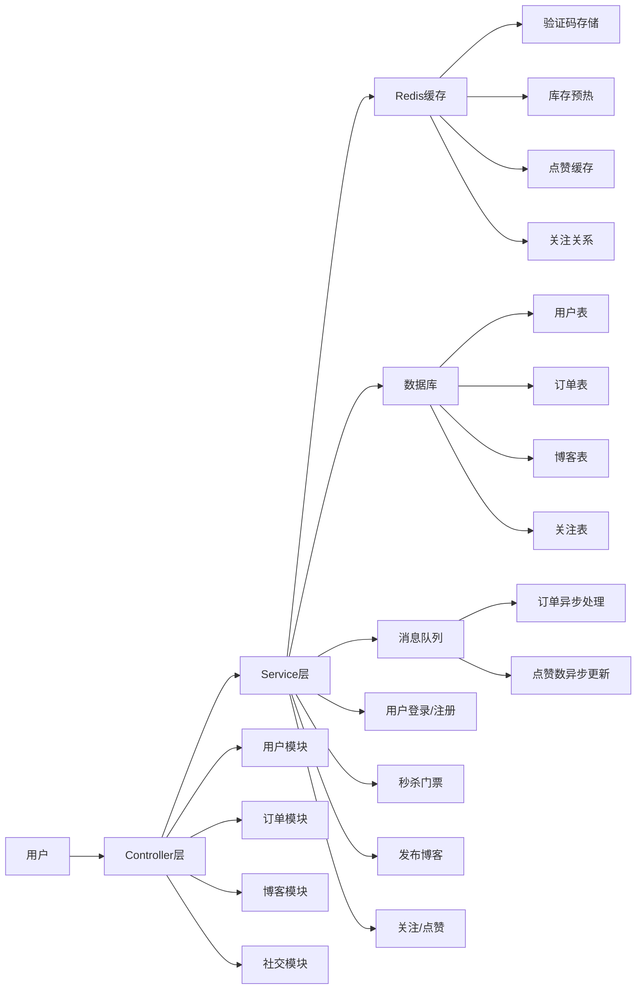

# 项目时序图文档

## 1. 用户登录时序图

---

## 2. 秒杀门票时序图

---

## 3. 关注用户时序图

---

## 4. 博客发布时序图

---

## 5. 点赞时序图

---

## 6. 行程规划时序图

---

## 7. 酒店预订时序图

---

## 8. 视频上传时序图

---

## 9. 团队创建时序图

---

## 10. 完整业务流程图

---

## 核心流程说明

| 流程 | 说明 | 关键技术点 |
|------|------|------------|
| 用户登录 | 手机号验证码登录 | Redis存储验证码 |
| 秒杀门票 | 高并发门票抢购 | 令牌桶限流 + Lua脚本 + 异步下单 |
| 关注用户 | 关注/取关操作 | Redis Set存储 |
| 博客发布 | 发布图文博客 | 基础CRUD |
| 点赞 | 点赞/取消点赞 | Redis缓存 + 异步消息 |
| 行程规划 | 创建行程添加项目 | 事务处理 |
| 酒店预订 | 房间预订 | 库存扣减 |
| 视频上传 | 视频发布 | 基础CRUD |
| 团队创建 | 创建旅行团队 | 队长自动加入 |
