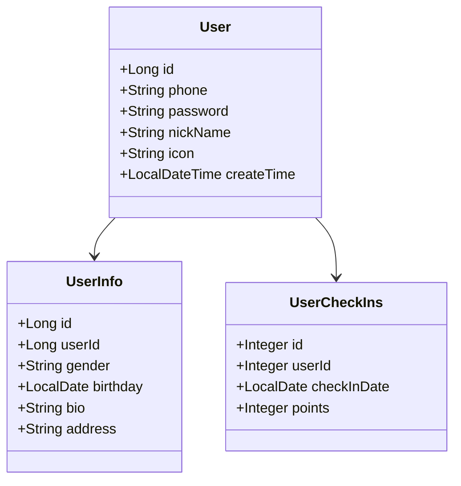
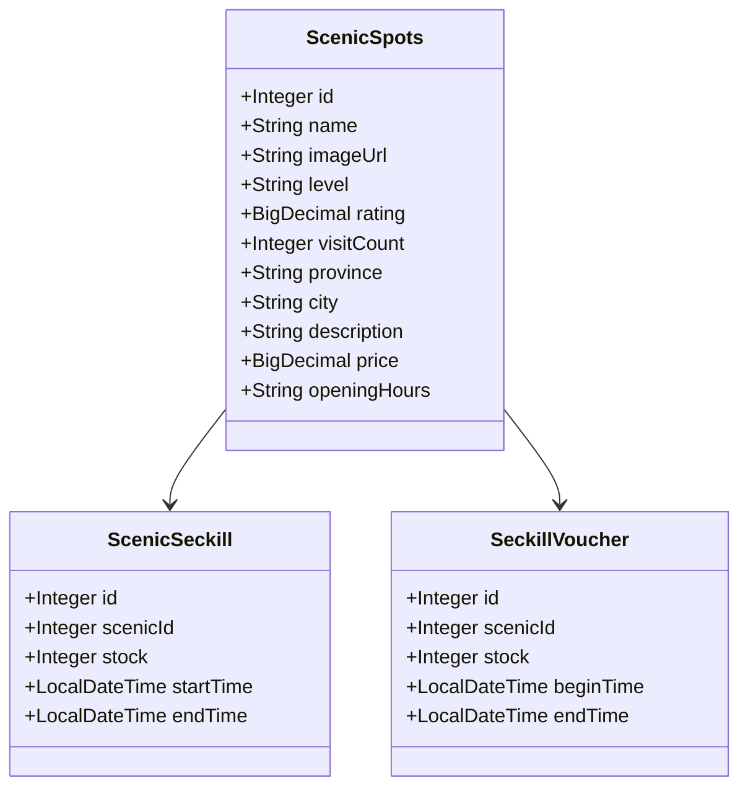
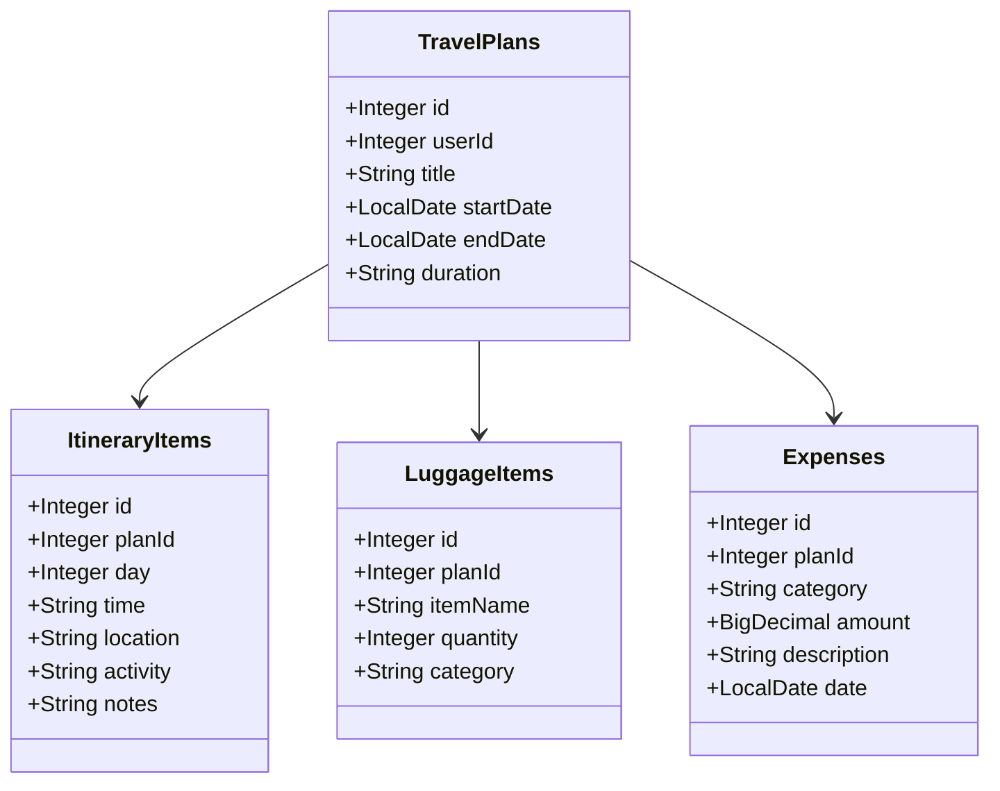
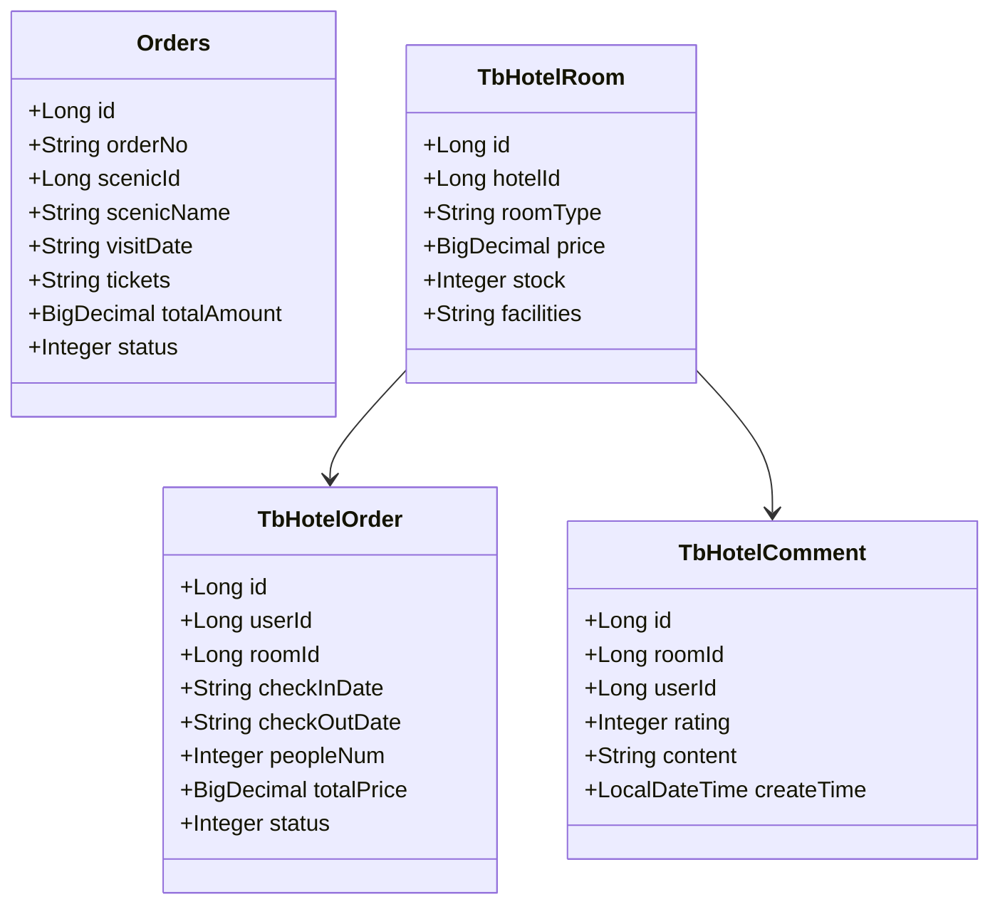
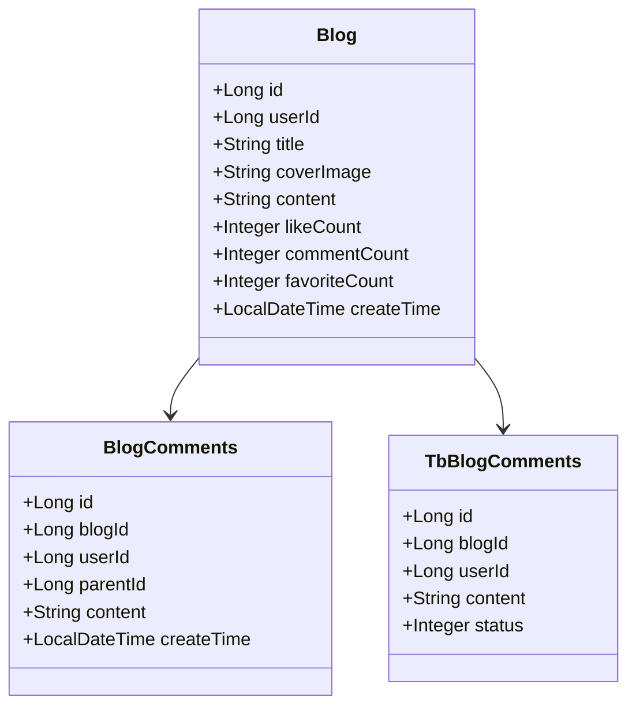
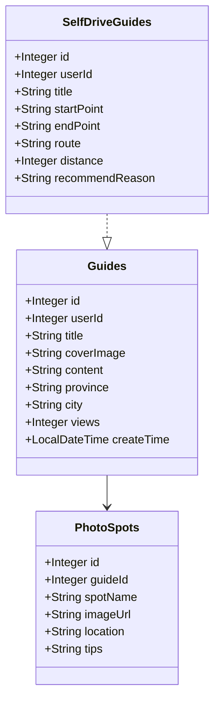
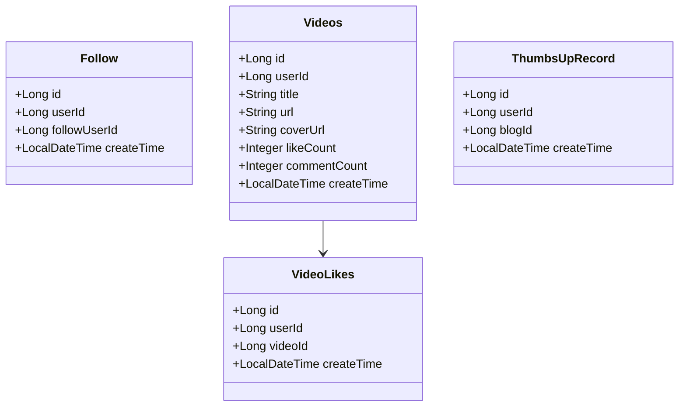
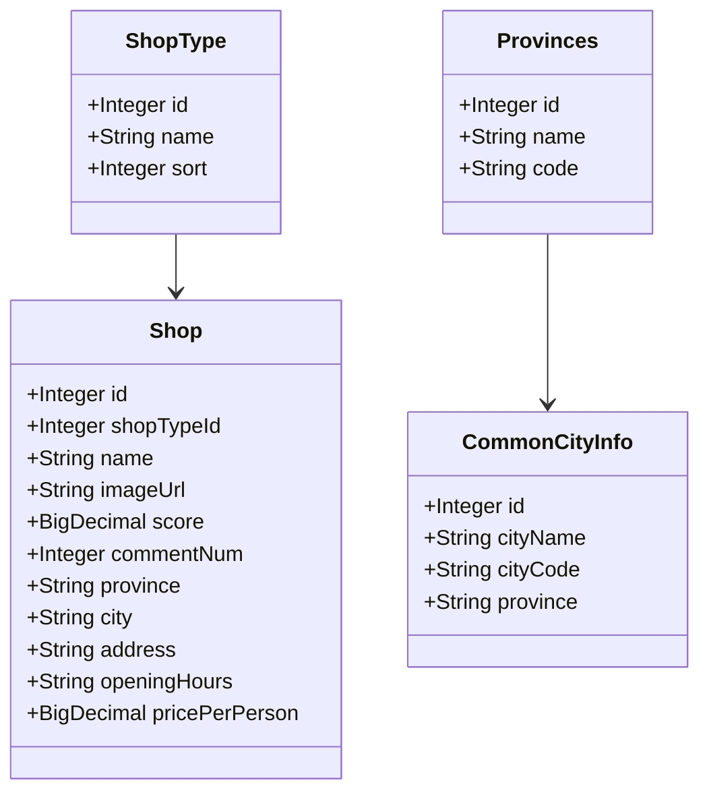
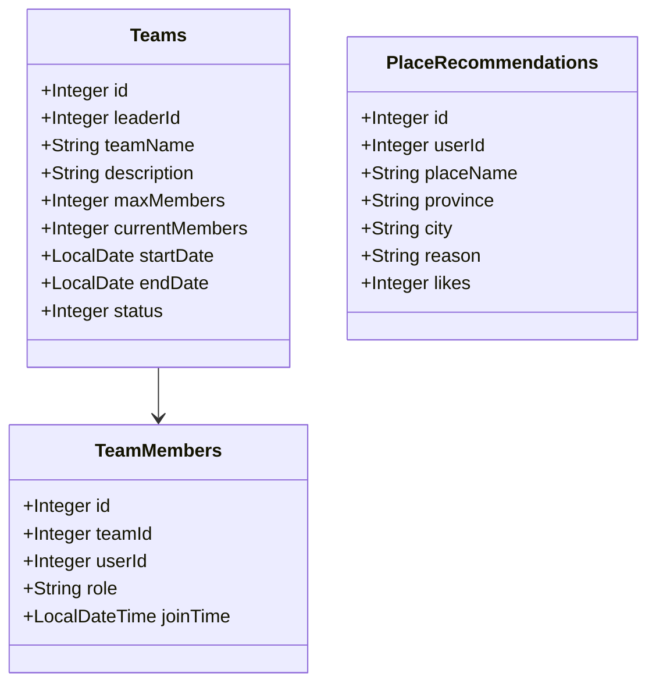

# 项目类图文档

## 1. 用户模块类图

---

## 2. 景点景区模块类图

---

## 3. 行程规划模块类图

---

## 4. 订单酒店模块类图

---

## 5. 博客社区模块类图

---

## 6. 攻略指南模块类图

---

## 7. 社交互动模块类图

---

## 8. 商铺模块类图

---

## 9. 团队模块类图

---

## 10. 完整架构图

```mermaid
graph TD
    A[项目架构] --> B[Controller层]
    A --> C[Service层]
    A --> D[Entity实体层]
    A --> E[Mapper层]
    
    B --> B1[用户Controller]
    B --> B2[景点Controller]
    B --> B3[行程Controller]
    B --> B4[订单Controller]
    B --> B5[博客Controller]
    B --> B6[攻略Controller]
    
    C --> C1[用户Service]
    C --> C2[景点Service]
    C --> C3[行程Service]
    C --> C4[订单Service]
    C --> C5[博客Service]
    C --> C6[攻略Service]
    
    D --> D1[User/UserInfo]
    D --> D2[ScenicSpots]
    D --> D3[TravelPlans]
    D --> D4[Orders]
    D --> D5[Blog]
    D --> D6[Guides]
    
    E --> E1[UserMapper]
    E --> E2[ScenicSpotsMapper]
    E --> E3[TravelPlansMapper]
    E --> E4[OrdersMapper]
    E --> E5[BlogMapper]
    E --> E6[GuidesMapper]
```

---

## 模块总结表

| 模块 | 主要实体 | 描述 |
|------|----------|------|
| 用户模块 | User, UserInfo, UserCheckIns | 用户信息、签到、积分 |
| 景点景区 | ScenicSpots, ScenicSeckill, SeckillVoucher | 景点信息、秒杀门票 |
| 行程规划 | TravelPlans, ItineraryItems, LuggageItems, Expenses | 行程安排、行李清单、费用记录 |
| 订单酒店 | Orders, TbHotelOrder, TbHotelRoom, TbHotelComment | 景点订单、酒店预订 |
| 博客社区 | Blog, BlogComments, TbBlogComments | 博客文章、评论互动 |
| 攻略指南 | Guides, SelfDriveGuides, PhotoSpots | 旅游攻略、自驾指南、拍照点推荐 |
| 社交互动 | Follow, Videos, VideoLikes, ThumbsUpRecord | 关注关系、短视频、点赞 |
| 商铺模块 | Shop, ShopType | 商家信息、分类 |
| 团队模块 | Teams, TeamMembers, PlaceRecommendations | 旅行团队、成员、地点推荐 |

---

## 技术架构

- **框架**: Spring Boot + MyBatis Plus
- **数据库**: MySQL
- **缓存**: Redis
- **消息队列**: RabbitMQ
- **分布式任务**: XXL-JOB
- **分布式锁**: Redisson

项目采用标准的 MVC 架构，层次分明，各模块职责清晰。
